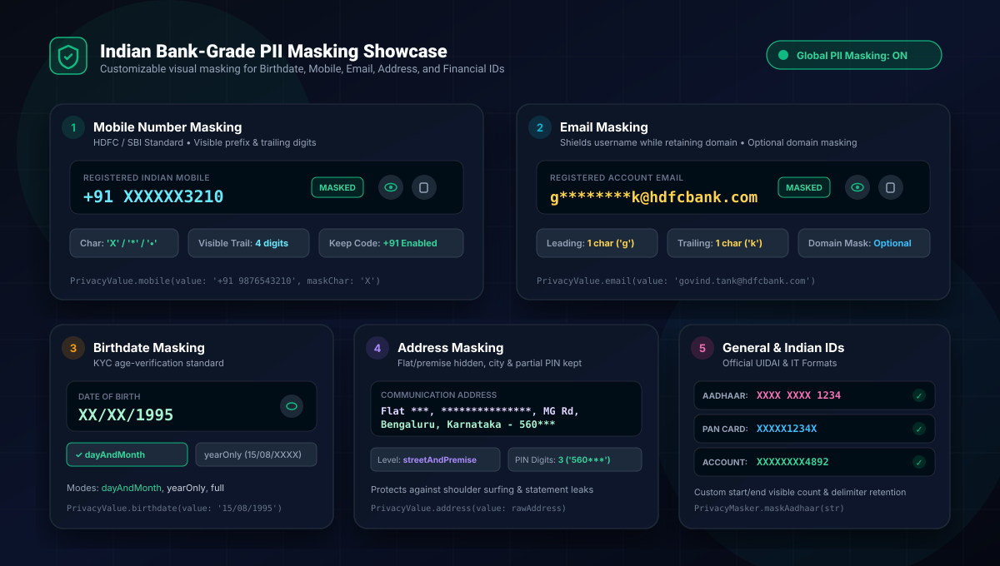
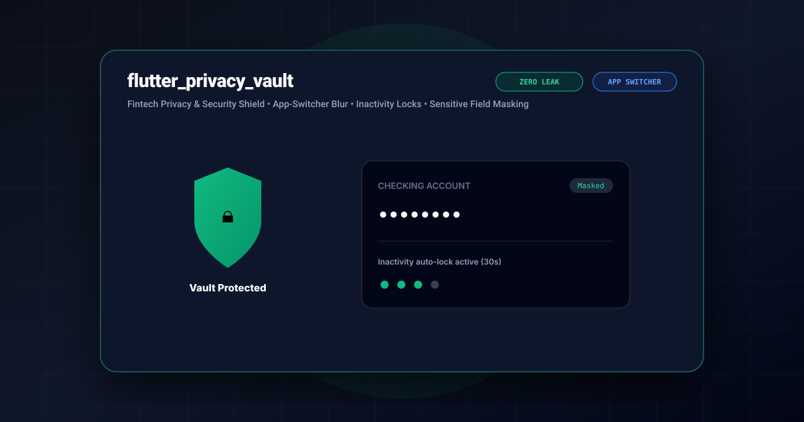

# flutter_privacy_vault

<p align="center">
  <a href="https://pub.dev/packages/flutter_privacy_vault"></a>
  <a href="https://pub.dev/packages/flutter_privacy_vault/score"></a>
  <a href="https://govindtank.github.io/flutter_privacy_vault/"></a>
  <a href="https://pub.dev/packages/flutter_privacy_vault"></a>
  <a href="https://github.com/govindtank/flutter_privacy_vault/actions"></a>
  <a href="LICENSE"></a>
</p>

<p align="center">
  
</p>

A production security and privacy vault for Flutter applications. Built for Fintech, Banking, Crypto, and Healthcare apps requiring **Indian bank-grade PII masking (Birthdate, Mobile, Email, Address, Aadhaar, PAN), app-switcher privacy shielding, inactivity auto-locking with biometric unlock, and sensitive balance masking**.

<p align="center">
  
</p>

---

## ⚡ Key Features

| Feature | Description | Inspired By |
|---|---|---|
| **1. Mobile Masking** | Preserves country code (`+91`), masks middle digits, reveals trailing 4 digits (`+91 ******3210`) | HDFC / SBI / ICICI |
| **2. Email Masking** | Shields username while keeping domain intact (`g********k@gmail.com`), optional domain shielding | Axis / Zerodha / Groww |
| **3. Birthdate Masking** | Masks Day & Month while keeping Year visible (`XX/XX/1995`) for KYC age verification | Indian Banking KYC |
| **4. Address Masking** | Hides flat & street details while keeping locality, city, state & partial PIN (`Bengaluru 560***`) | Bank Statements / Credit Cards |
| **5. General Masking** | Official UIDAI Aadhaar (`XXXX XXXX 1234`), Income Tax PAN (`XXXXX1234X`), and Bank Account masking | UIDAI / IT-Dept / RBI |
| **Interactive `PrivacyValue`** | 1-tap eye reveal toggle, timed auto-reobscure (5s), and secure clipboard copy | Production Banking Apps |
| **App-Switcher Shield** | Blurs or obscures the app snapshot when backgrounded or in multitasking tray | iOS & Android Security |
| **Inactivity Auto-Lock** | Detects idle touch, pointer, and key events, locking the vault with shuffled PIN pad | FINTECH Compliance |

---

## 🚀 Quick Usage

### 1. Bank-Grade PII Masking with `PrivacyValue` Widget

```dart
// 1. Mobile Number Masking (e.g. +91 ******3210)
PrivacyValue.mobile(
  value: '+91 9876543210',
  label: 'Registered Mobile',
  visibleTrailing: 4,
  maskChar: 'X',
  showEyeToggle: true,
  showCopyButton: true,
  autoObscureDuration: const Duration(seconds: 5),
)

// 2. Email Masking (e.g. g********k@hdfcbank.com)
PrivacyValue.email(
  value: 'govind.tank@hdfcbank.com',
  label: 'Registered Email',
  visibleLeading: 1,
  visibleTrailing: 1,
  showEyeToggle: true,
)

// 3. Birthdate Masking for KYC (e.g. XX/XX/1995 or 15/08/XXXX)
PrivacyValue.birthdate(
  value: '15/08/1995',
  label: 'Date of Birth',
  dateStyle: DateMaskStyle.dayAndMonth, // or yearOnly, dayAndYear, full
)

// 4. Address Masking (e.g. Flat ***, ***************, Bengaluru 560***)
PrivacyValue.address(
  value: 'Flat 402, Lotus Residency, MG Road, Bengaluru, Karnataka 560038',
  label: 'Communication Address',
  addressLevel: AddressMaskLevel.streetAndPremise,
  visiblePinDigits: 3,
)

// 5. Official Indian Banking Presets
PrivacyValue(value: '5432 9876 1234', type: PrivacyValueType.aadhaar)   // XXXX XXXX 1234
PrivacyValue(value: 'ABCDE1234F', type: PrivacyValueType.pan)           // XXXXX1234X
PrivacyValue(value: '50100234589211', type: PrivacyValueType.bankAccount) // XXXXXXXX9211
```

---

### 2. Pure Dart `PrivacyMasker` & String Extensions

```dart
import 'package:flutter_privacy_vault/flutter_privacy_vault.dart';

// Mobile Phone
'+91 9876543210'.maskMobile(); // '+91 XXXXXX3210'

// Email
'govindtank@gmail.com'.maskEmail(); // 'g********k@gmail.com'

// Birthdate (Day & Month masked for KYC)
'15/08/1995'.maskBirthdate(); // 'XX/XX/1995'
'15/08/1995'.maskBirthdate(style: DateMaskStyle.yearOnly); // '15/08/XXXX'

// Postal Address
'Flat 402, Lotus Residency, MG Road, Bengaluru 560038'.maskAddress();
// 'Flat ***, ***************, MG Road, Bengaluru 560***'

// Aadhaar & PAN Card
'5432 9876 1234'.maskAadhaar(); // 'XXXX XXXX 1234'
'ABCDE1234F'.maskPan();         // 'XXXXX1234X'
```

---

### 3. App-Switcher Shield & Inactivity Lock Setup

```dart
MaterialApp(
  builder: (context, child) {
    return PrivacyVault(
      config: PrivacyVaultConfig(
        enableBackgroundShield: true,
        inactivityTimeout: const Duration(seconds: 45),
        lockOnInactivity: true,
        maskSensitiveDataByDefault: true,
        correctPin: '1234',
        shufflePinKeypad: true,
      ),
      child: child!,
    );
  },
  home: const BankingDashboard(),
);
```

---

### 4. Global Programmatic Controls

```dart
// Toggle masking globally for all PrivacyValue and PrivacyMask widgets
PrivacyVaultController.toggleDataMasking();

// Manually lock vault (e.g. user taps "Lock Now")
PrivacyVaultController.lock();

// Unlock vault (e.g. after biometric fingerprint check)
PrivacyVaultController.unlock();
```

---

## 💖 Support the Project

If you find this project useful, consider supporting its active maintenance and future development:

<p align="left">
  <a href="https://buymeacoffee.com/govindtanko"></a>
  <a href="https://github.com/sponsors/govindtank"></a>
  <a href="https://www.patreon.com/govindtank"></a>
</p>

---

## 📄 License

This project is licensed under the Apache License 2.0 - see the [LICENSE](LICENSE) file for details.

*Maintained with ❤️ by [Govind Tank](https://github.com/govindtank).*
